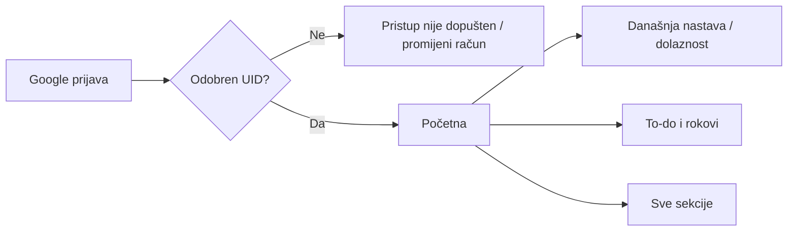

# App Flow

2026-10-11 rate: Početna → Podsjetnici za rate → Rate fakulteta. Zaseban online prikaz neplaćenih rata od 30 dana prije roka; poruka zadnjih 7 dana i na dueOn, paid odmah nestaje nakon server refresha. Dodatne stranice imaju Učitaj još podsjetnika; error/offline označavaju zadnje učitane podatke. Ostale obaveze ostaju u 14-day rasponu. Prikaz je lokalno provjeren, nije deployan; mobile push još Proposed, bez permission prompta ili zakazanog slanja.

Update 2026-10-11: Raspored → Uvezi TVZ raspored → lokalni ICS preview → odabir grupa/datum/učionica → potvrda u izabranom semestru. Predavanja su početno odabrana; vježbe korisnik uključuje. Nedostajući semestar dodaje se kroz Postavke. Import može stati djelomično; vidljivi potvrđeni napredak i retry preskaču postojeće. Dodaj pojedinačni termin ima kolegij/lecture-exercise/datum/vrijeme/lokaciju. Otkaži termin + Sakrij otkazane uklanja iz aktivnog prikaza uz sačuvanu povijest; Prikaži otkazane + Vrati u održano vraća neoznačen termin. Detaljni source/operativni ugovor u SCHEDULE_IMPORT.md.

Datum: 2026-10-07. Bootstrap baseline; UI hrvatski, online PWA.

Implementirani podskup 2026-10-08 (TASK-002/003): /login, /settings semestri, /courses i /courses/:id. Odjava je dostupna u headeru svih privatnih ekrana. Postavke nude dodavanje/uređivanje semestra, aktualni kontekst, arhivu i pregled kolegija pojedinog semestra. Kolegiji imaju odabrani semestar, informacije/linkove, detalj i eksplicitni Uredi arhivu. Arhiva ne briše povijest; arhivirani semestar ne može biti aktualni. Course upis ne premješta se u drugi semestar.

Forme čekaju server potvrdu, čuvaju input pri grešci i pokazuju konflikt s aktualnim server zapisom te akcijom Učitaj novu verziju uz potvrdu odbacivanja. Offline stanje blokira spremanje; nakon povratka veze osvježavaju se server podaci. Nespremljene izmjene traže potvrdu pri promjeni konteksta/navigaciji/odjavi. Podatkovni error ima Osvježi ponovno. TASK-004–007 dodali su raspored/dolaznost/provjere/projekte/To-do/diplomski, prema izvedbenim sekcijama na kraju dokumenta. Rate, objedinjena Početna, obračun bodova i backup ostaju budući journeys.

## 1. Navigacija i screen inventory

Laptop: stalna bočna navigacija. Mobitel: Početna, Raspored, To-do, Sve sekcije. Dolaznost, kolegiji, provjere, projekti, diplomski i rate imaju izravan ulaz kroz Sve sekcije. Backup/odjava i semestar u postavkama.

| ID | Ekran / predložena ruta | Svrha | FR |
|---|---|---|---|
| SCR-001 | /login | Google prijava i odbijen pristup | FR-001 |
| SCR-002 | / | Današnja nastava i obaveze | FR-013 |
| SCR-003 | /courses; /courses/:id | Kolegiji, informacije, rezultati/uvjeti i povezani sadržaji | FR-003, FR-014, FR-015 |
| SCR-004 | /schedule | Dan/tjedan i uređivanje ponavljanja | FR-004, FR-007 |
| SCR-005 | /attendance | Pregled kolegija i odvojene evidencije predavanja/vježbi | FR-005, FR-006 |
| SCR-006 | /assessments; /assessments/:id | Provjere, svi pokušaji i rezultati | FR-008, FR-014 |
| SCR-007 | /projects; /projects/:id | Projekti, zadaci i rezultat | FR-009, FR-014 |
| SCR-008 | /todo | Svi taskovi i kontekstni filtri | FR-010 |
| SCR-009 | /thesis | Osnovni diplomski i zadaci | FR-011 |
| SCR-010 | /installments | Rate i oznaka plaćanja | FR-012 |
| SCR-011 | /settings | Semestri/arhiva, backup/povrat, odjava | FR-002, FR-017 |
| SCR-012 | /sections | Sve sekcije, posebno brzi mobile pristup | FR-018 |

Produkcijski tok: sve osim login zahtijeva odobreni UID. TASK-001 je lokalni javni pregled sučelja bez privatnih podataka i Firebase veze; auth guard i /login implementiraju se u TASK-002. Ovaj pregled nije spreman za objavu. Izravna ruta vraća loading pa sadržaj ili jasnu poruku za nepostojeći/arhivirani zapis; nema praznog bijelog ekrana.

## 2. Početni i glavni journey

Prvi ulaz s praznim dataset-om: pomoćni empty state za unos semestra/kolegija/rasporeda. Ne stvara sintetičke kolegije niti zahtijeva poznatu temu diplomskog. Prijava se obnavlja kroz provider; expired session traži ponovnu prijavu, uz očuvanje nespremljenog unosa unutar tekuće stranice.

## 3. Primary flows

- FL-001 / FR-005: Početna → današnji termin → Prisutan/Odsutan → spremanje → server potvrda. Naknadni ispravak iz Dolaznosti/kolegija. Otkazani termin ne nudi unos prisutnosti; za povrat u održano najprije ispraviti stanje termina.
- FL-002 / FR-004, FR-007: Raspored → dodaj ponavljanje unutar semestra → preview termina → potvrdi. Promjena ima datum primjene; povijest se ne regenerira. Otkazivanje jednog termina i zasebna nadoknada dostupni iz detalja termina.
- FL-003 / FR-010: To-do → Dodaj → naziv i opcionalni rok/kontekst → spremi. Kontekst projekta uključuje njegov kolegij. Dovrši/ponovno otvori s feedbackom; tekst taska nema automatski AI obradu.
- FL-004 / FR-008, FR-014: Provjera → unesi datum/vrstu → kasnije dodaj pokušaj s bodovima/ocjenom → povijest. Ispravak postojećeg pokušaja ne stvara novi izlazak. Obavljeno i rezultat zasebni.
- FL-005 / FR-015: Kolegij → Rezultati i uvjeti → rezultati po izvoru i pregled obračuna. Bez pravila poruka Pravila ocjenjivanja još nisu unesena. Bez riješenog pokušaja/komponente prikaz nepotpunosti. Službena ocjena može biti unesena zasebno; ne prepisuje se izračunom.
- FL-006 / FR-009, FR-011: Projekt/diplomski → informacije → povezani taskovi → dodaj/dovrši. Tema i mentor opcionalni. Završavanje projekta ne dovršava automatski sve taskove.
- FL-007 / FR-012: Rata → naziv, iznos EUR, rok → spremi → označi plaćeno → makne se iz neplaćenih obaveza; moguć ispravak oznake.
- FL-008 / FR-002: Postavke → aktivni semestar/arhiva → pregled starog → Uredi arhivu za izričitu korekciju. Novi semestar ne prepisuje stare kolegije.
- FL-009 / FR-017: Postavke → Export → konzistentna kopija → lokalni download JSON. Povrat: odaberi datoteku → validacija/sažetak → upozorenje na zamjenu → potvrdi → privremeno zaključavanje uređivanja → staged import → potvrđeno prebacivanje → refresh. Greška ostavlja staru aktivnu kopiju; oporavak prekida zaključavanje uz jasnu poruku.

## 4. UI stanja i responsive ponašanje

Za svaki ekran: loading s rezerviranim prostorom; empty state s relevantnom akcijom; actionable error i retry; success tek nakon potvrde; disabled/loading tijekom mutacije. Ne oslanjati se samo na toast za stanje neuspjelog unosa.

Bez interneta: banner Nema internetske veze, izmjene disabled; zadržati postojeći prikaz označen kao zadnje učitan, ne kao svjež. Nespremljen obrazac ostaje u memoriji, bez obećanja oporavka nakon zatvaranja. Po povratku mreže server refresh prije novih promjena. Ne stvarati offline queue.

Konflikt: Sačuvano je na drugom uređaju, prikaži novi zapis i očuvaj lokalni unos za odluku korisnika; nema automatskog prepisivanja.

Mobile: liste/kartice umjesto širokih tablica; tjedan može biti lista dana, današnja nastava istaknuta. Desktop: tjedna mreža i usporedni paneli. Isti podaci/radnje na oba prikaza. Sve akcije dostupne bez hovera.

## 5. Destruktivne radnje i update

Brisanje nepovezanog zapisa, zamjena backupom i otkazivanje s postojećom evidencijom traže potvrdu posljedica. Povezani parenti arhiviraju se umjesto kaskadnog brisanja. Odjava upozorava na nespremljen unos. PWA update nudi osvježavanje; ne reloadati usred uređivanja/restorea.

## Implementirano TASK-004/005 — 2026-10-09

Raspored nudi dan/tjedan, promjenu datuma i unos recurring predloška s previewom broja/prvog/zadnjeg termina. Edit traži datum buduće primjene; recorded budući termin blokira edit, bez automatskog prepisivanja. Detalji termina nude otkazivanje/ponovno aktiviranje i manual nadoknadu. Početna prikazuje današnju nastavu i izravne Prisutan/Odsutan/Poništi akcije.

Dolaznost bira kolegij, prikazuje odvojene predavanja/vježbe, nullable ukupni/minimalni broj, osobni postotak i preostale dolaske. Povijest završene nastave ima filter i load-more. Arhiva traži eksplicitno uključivanje korekcija. Error/conflict čuva unos; refresh prikazuje server zapis, bez tihog overwritea. Success tek nakon commit-a. Pending write blokira route promjenu/odjavu i aktivira native beforeunload upozorenje; prisilno zatvaranje browsera nije pouzdano spremanje. Nema offline queue.
## Implementirano TASK-006/007

/assessments i /assessments/:id: unos naziva/vrste/kolegija/datuma/opcionalnog vremena, obavljeno/reopen, dodavanje i ispravak pokušaja. /projects i /projects/:id: optional course/rok, obavljeno/reopen, archive/reopen archive, ResultHistory i povezani taskovi. Zatvaranje projekta ne zatvara taskove.

/todo je jedna paginirana lista s context/status server filterima, optional datumom, edit/complete/reopen. Projekt/thesis prikazi daju context-filtered isti task. /thesis ima singleton informacije bez obvezne teme/mentora i istu listu taskova. Sve sekcije imaju izravan nav ulaz; detalji imaju povratak na listu/Sve sekcije.

Kolegij povezuje provjere/projekte/course task filter query parametrima i eksplicitni read-only pregled canonical pokušaja. Pravila za zbroj/ocjenu nisu unesena; nema birača best/latest niti fake calculated grade. Ocjena je optional plain text.

Forme zadržavaju vrijednosti i expected revision pri refreshu/konfliktu. Conflict prikazuje server opis i potvrđeni discard/refresh ulaz. Offline disabled i RAM draft, server-confirmed success, globalni pending navigation/logout guard. Arhiva blokira korekcije do Uredi arhivu; history se čuva. Fizički uređaji/OAuth/cloud još nisu provjereni.

## TASK-008/009 — implementirani journeys

/installments: Dodaj/Uredi ratu, EUR/rok/paid flag, paid/reopen, server potvrda, conflict nova verzija i preserved input, RAM draft/offline/paging. Početna: danas quick attendance, svi overdue + idućih 14 dana, otvoreni zadaci i izravni linkovi; Učitaj još za daljnje stranice. Plaćene/dovršene/arhivirane obaveze isključene.

Kolegij → Prikaži bodovanje: Dodaj lecture/exercise activity, urediti uvjete postojećih canonical aktivnosti, sačuvati sve pokušaje, Uredi pravila s komponentama/intervalima i eksplicitnim izborom, Uredi službeni rezultat. Osobni izračun prikazuje subtotal, grade ili razloge nepotpunosti; službeni zapis ostaje zaseban. Arhiva traži Uredi arhivu bodovanja. Form refresh ne prepisuje dirty draft/revision; conflict nudi novi server zapis uz potvrdu discard-a. Stvarno TVZ konfiguriranje TASK-009C ostaje otvoreno.

## TASK-010/011 — implementirani tokovi

Postavke → Sigurnosna kopija: preuzmi current/previous, odaberi JSON, validirani preview brojeva i eksplicitna potvrda cijelog povrata. Invalid/oversized/unknown schema/ref datoteka daje grešku prije locka. Progress označava staging, success tek nakon server potvrđene aktivacije. Prekinuti restore prikazuje lock i Prekini povrat, bez zamjene aktivne evidencije. Napuštene kopije pronađi i obriši zasebno uz potvrdu; active/previous/staging zaštićene.

Promijenjeni dataset na bilo kojem klijentu → globalna poruka, stari unos ostaje vidljiv, writes blokirani; Učitaj obnovljene podatke traži potvrdu dirty unosa. Nema tihog refresh-a otvorene forme u novu generaciju s resetiranim revizijama.

Production PWA: instalacija se nudi samo kada preglednik ponudi prompt; Postavke imaju i iPhone/Safari uputu. Update čeka korisnika; dirty/pending/lock/offline/stale dataset blokira učitavanje nove verzije. Ako drugi tab aktivira worker, ostali tabovi dobiju ponudu i ostaju otvoreni bez automatskog reloada. Bez interneta shell može ostati dostupan, ali to nije offline evidencija niti queue.
