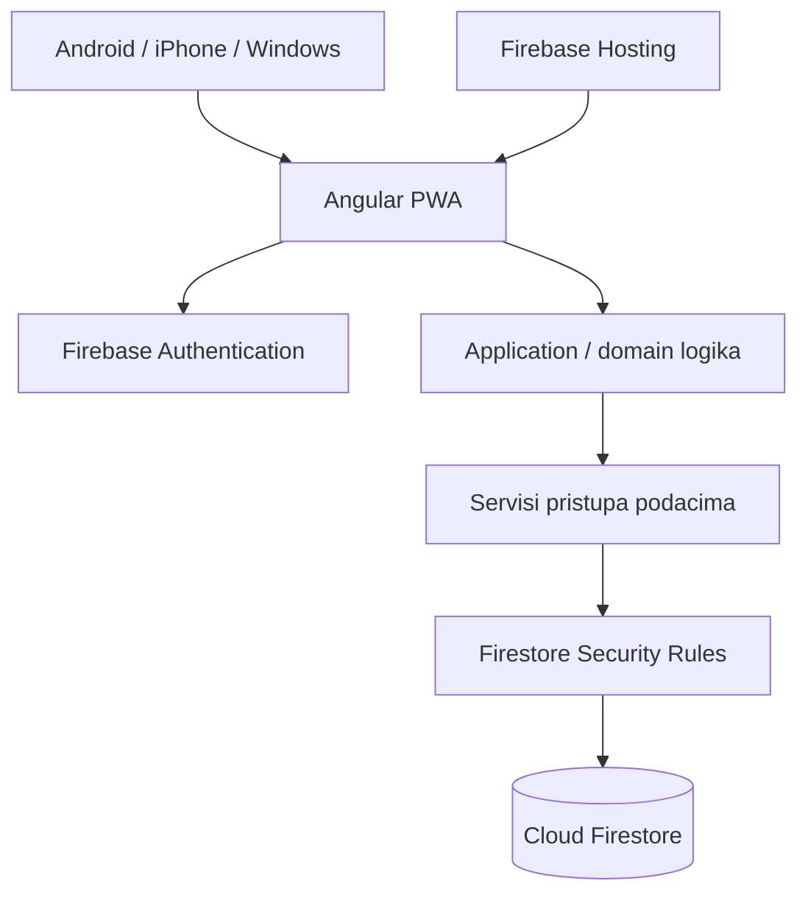

# Arhitektura

31.10.2026. — UX promjene zadržavaju postojeće page-scoped stores, domain funkcije i SDK granice. Zajednički EditorDialogComponent koristi HTML dialog.showModal(), dostupno kruženje/povrat fokusa i postojeće UnsavedChangesService potvrde. DialogStateService koordinira prikaz jedne dostupne globalne statusne poruke u aktivnom obrascu; ne pohranjuje akademske podatke. ScheduleStore izlaže activeRows/todayRows nad istim occurrences snapshotom i osvježava Zagreb sat na focus/visibility. Nema schema/Rules/migracije, trajnog cachea, queuea ni novih dependencies. Korisnik odustao od izravne Outlook integracije; .ics ostaje ručni export.


23.10.2026. — FirestoreContext koristi forced long-polling s najduljim idle odgovorom5s **samo u emulator modu** radi WebKit/Windows loopback stream zastoja. Production mode zadržava izvorne SDK transport defaults i memory-only cache; nema offline queue, UA grananja, backenda ili data ugovorne promjene. [Firebase transport opcije](https://firebase.google.com/docs/reference/js/firestore.firestoresettings) i [timeout ugovor](https://firebase.google.com/docs/reference/js/firestore.experimentallongpollingoptions). To je lokalna kompatibilnost, ne dokaz Safari/cloud performansi.

20.10.2026. — /reminders je lazy feature nad postojećim page-scoped PlanningStore/ScheduleStore servisima. Pure domain/reminders pretvara provjerene deadline/session podatke u objedinjene view modele i RFC5545 tekst; UI samo preuzima Blob. Oba storea objavljuju loaded dataset/revision radi blokiranja izvoza iz različitih snapshotova. Nema backend/SDK poziva iz UI-ja, novog push servisa, sinkronizacije ili dependencies. Jedini additive data contract je excused/opcionalni absenceNote na sessions, prema DATABASE/SECURITY; deployment treba kompatibilni frontend i owner Rules.

Datum: 2026-10-07  
Status: bootstrap baseline za korisnikov pregled. Scope/stack potvrđeni; izvedbeni detalji i otvorene granice navedeni su ispod i u auditu.
Update 2026-10-09, TASK-001–007: standalone/zoneless shell, Auth/Firestore data adapteri, pure domain validacija i semestar/kolegij/raspored/dolaznost UI implementirani su lokalno. Production konfiguracija i Rules zatvorene su do cloud faze. PWA manifest/ikone postoje; TASK-011 dodao je public-shell service worker i lokalni install/update smoke; native device dokaz još slijedi. Provjere/projekti/To-do/diplomski implementirani su lokalno kroz WorkRepository i page-scoped WorkStore. Rate, objedinjena Početna i generičko bodovanje imaju TASK-008/009 lokalnu provedbu; stvarne konfiguracije čekaju TASK-009C.

## 1. Svrha i potvrđene odluke

Osobna aplikacija za fakultetske obaveze na Androidu, iPhoneu i Windowsu. Hrvatski UI. Jedan odobren korisnik, zajednički online podaci, bez ovisnosti o uključenom laptopu.

Potvrđeni stack: Angular/TypeScript, PWA, Firebase Authentication s Google prijavom, Cloud Firestore, Firebase Hosting; početni plan Spark. Preferirano 0 EUR, prihvatljivo do 5 EUR mjesečno ukupno, bez aktivacije naplate tijekom bootstrapa.

ADR zapisi: [platforma](decisions/ADR-001-platform.md), [stack](decisions/ADR-002-stack.md), [pristup](decisions/ADR-003-access.md).

## 2. System context



Vlastiti backend server nije planiran za potvrđeni MVP. Firebase usluge čine serversku infrastrukturnu granicu. Potrebu za dodatnom serverskom obradom ponovno procijeniti nakon konkretizacije sigurnog povrata i povezanih promjena podataka.

## 3. Odgovornosti i granice

| Dio | Odgovornost | Granica |
|---|---|---|
| Feature UI | Ekrani, forme, navigacija i feedback | Nema izravnog Firebase pristupa ni vlastitih formula za rezultate |
| Application logika | Koordinacija korisničkih radnji i povezanih promjena | Nema ovisnosti o prikazu pojedinog ekrana |
| Domain logika | Izračuni i izričita pravila proizvoda | Ne izmišlja pragove ni TVZ pravila; nema UI/Firebase poziva |
| Data servisi | Čitanje, spremanje, mapiranje i rukovanje pogreškama | Ne donose nove product odluke |
| Shared UI | Reusable komponente i design tokeni | Ne sadržava logiku konkretnog kolegija |
| Security Rules | Dopušteni UID i validacija pristupa/zapisa | UI guard nije autorizacija |

Predloženi featurei: Početna, Kolegiji, Dolaznost, Raspored, Provjere znanja, Projekti, To-do, Diplomski, Rate fakulteta. Rezultati su povezani dio kolegija i pripadajućih aktivnosti; izdvojena navigacijska sekcija nije potvrđena.

Struktura; implementirani dijelovi i buduće funkcije navedeni su u CURRENT_STATE:

```text
src/app/
  core/            # auth, config, application errors, dataset context
  domain/          # pure models, validation, attendance/grading functions
  data/            # Firebase adapters, transactions, backup/restore
  features/        # home, courses, attendance, schedule, assessments,
                   # projects, todo, thesis, installments, settings
  shared/ui/       # reusable components
  shared/styles/   # tokens
firebase/          # Rules, indexes i emulator konfiguracija
tests/firebase/    # Rules/integration i sintetičke fixtures
e2e/               # Playwright browser journeys
docs/
```

Standalone Angular, lazy feature routes, typed reactive forms i signals. FirebaseContextService konfigurira SDK; AuthService promatra prijavu; AcademicRepository provodi server reads/transakcije. AcademicStoreService koordinira session, pagination, refresh i UX stanja, bez logike pojedinog ekrana. SDK listeneri imaju lifecycle cleanup. UI nema SDK pozive; domain nema Angular/network ovisnosti. Bez NgRx/generic base repositoryja ili vlastitog servera.

## 4. Domain koncepti prije database modela

- Semestar grupira aktualne kolegije; arhiva čuva povijest uz izričito uređivanje.
- Kolegij povezuje informacije, nastavu, dolaznost, provjere, projekte i zadatke.
- Tjedni termin/predložak opisuje ponavljanje; konkretan termin ima datum i može biti otkazan ili nadoknađen.
- Dolaznost pripada konkretnom terminu; predavanja i vježbe vode se odvojeno.
- Provjera znanja pripada kolegiju i ima sačuvane pokušaje/rezultate.
- Bodovana aktivnost predstavlja konkretan rezultat vježbi, predavanja, provjere ili projekta kada pravila tako određuju.
- Projekt može pripadati kolegiju i ima zadatke; završetak je zaseban od ocjene.
- Task je samostalan ili povezan s kontekstom; postoji jednom, iako se prikazuje na više mjesta.
- Diplomski postoji prije poznate teme i mentora; početni opseg je osnovna evidencija i zadaci.
- Rata ima iznos u EUR, rok i ručno plaćeno/neplaćeno; nema djelomičnih uplata.

Domain koncepti prevedeni su u [DATABASE.md](DATABASE.md). Jedna canonical scoreAttempts evidencija sadrži bodove/ocjenu; scoreActivities povezuje je s izvorom. Ne spremati drugi zbroj na kolegij kao autoritativni rezultat.

## 5. Potvrđena pravila i otvoreni dijelovi

### Nastava i dolaznost

- Jedan termin ima jednu promjenjivu evidenciju; ponovljena radnja ne stvara dodatni dolazak.
- Neoznačeno nije odsutno. Otkazano nije izostanak.
- Službeni ukupan broj i minimum dolazaka korisnik unosi i mijenja ručno.
- Nadoknada je zaseban termin; promjena budućeg rasporeda ne mijenja povijest.
- Display formula i nepoznata pravila u PRD/DATABASE; one block=one session početni ugovor, stvarnu granularnost i početak/kraj nastave verificirati prema dostavljenom rasporedu.

### Bodovi i ocjene

- Pojedinačni bodovi unose se, a ukupni bodovi zbrajaju automatski.
- Ocjena se računa iz bodova prema pravilima konkretnog kolegija.
- Projektni bodovi uključuju se prema pravilima kolegija.
- Čuvaju se svi pokušaji. Politika uključivanja pojedinog pokušaja nije odabrana i trenutačno nije discovery prioritet.
- Pravila kolegija korisnik dostavlja naknadno. Ne implementirati univerzalne pragove, best/latest attempt politiku, zaokruživanje ili automatske bodove dolaznosti bez specifikacije.
- Invariant baselinea: jedan stvarni rezultat broji se jednom, bez obzira na broj prikaza.
- UX baselinea: bez pravila nema izračunate ocjene; nepotpuni rezultati moraju biti vidljivo nepotpuni, bez predstavljanja izračuna kao službenog konačnog rezultata. Grade skala i intervali nisu univerzalni; službena unesena ocjena odvojena je od osobnog izračuna.

## 6. Pristup i pouzdano spremanje

Pristup samo odobrenom UID-u kroz Security Rules. Neodobreni Google račun može biti autentificiran, ali ne smije pristupiti podacima. Stvarni UID i cloud konfiguracija postavljaju se poslije odobrenja implementacije.

Potvrđeni zahtjevi: feedback spremanja, očuvanje unosa pri pogrešci, ponovni pokušaj, osvježavanje pri povratku u app i zaštita od neprimjetnog pregaženja istodobnih izmjena. Izvedbeni izbor: expected revision transakcija po zapisu + root dataRevision za export/lock. Detalji u DATABASE. Transaction callback nema UI side-effecta.

MVP je online. Firestore persistent offline cache nije uključen. Network-disabled mutacije, server potvrda writea i refresh po povratku veze. Service worker cache samo app shell/static, bez private API/Auth cachea. Update se nudi kad nema nespremljenog unosa ili restorea. PWA ne daje odobrenje za offline sinkronizaciju.

Rokovi bez vremena čuvaju značenje datuma. Nastava ima datum/vrijeme prema Europe/Zagreb; detaljna storage konvencija slijedi u DATABASE.md.

## 7. Backup, testiranje i deployment

Ručni export/povrat je MUST. Backup ne sadržava prijavne tokene. Prihvaćeni ADR-004 (2026-10-10): izolirana dataset staging kopija, privremeni lock, readback i atomarna promjena active pointera; stara kopija ostaje pri grešci. Zbog višegodišnje povijesti ne koristiti jedan neograničen batch ni parcijalnu zamjenu aktivne kopije. DATABASE definira faze i recovery. ADR-004 Accepted od korisnika 2026-10-10; TASK-010 lokalno implementiran.

Test strategija: Vitest/Angular TestBed, Firebase emulator/Rules i Playwright browser tokovi, zatim stvarni device/OAuth smoke. [TESTING.md](TESTING.md) mapira FR-001–FR-018 na TC-001–TC-018. Lokalni alati su instalirani i provjereni; CI nije konfiguriran. GitHub Actions verification samo ako se kasnije odobri remote repository; nema automatic deploymenta.

Hosting je potvrđen, ali nijedan Firebase projekt nije kreiran u ovoj sesiji. [DEPLOYMENT.md](DEPLOYMENT.md) definira pripremu, kvote, odobreni UID, konfiguraciju i release. EU lokacija baze i konkretne kompatibilne verzije odabiru se pri foundation/deploy taskovima i bilježe, prije nepovratnog cloud koraka.

## 8. Spremnost

- Potvrđeno: platforma, stack, glavne granice, jedan korisnik i ključni tokovi.
- Ready za pregled i foundation: model/granice, concurrency plan, PWA ponašanje i ugovori.
- Partially defined: stvarno bodovanje, izbor pokušaja, decimal/granularnost edge pravila; staged restore je Accepted i implementiran lokalno; cloud/device recovery smoke čeka.
- Čeka korisnikove informacije: sadržaj i konkretna pravila svih kolegija, raspored i stvarni uvjeti dolaznosti.

Planning readiness i povijesni audit: [CONSISTENCY_AUDIT.md](CONSISTENCY_AUDIT.md). TASK-001–007 imaju izričito odobrenje implementacije; aktualni runtime dokazi i granice nalaze se u CURRENT_STATE.

## TASK-004/005 — izvedene granice

Pure schedule domain helpers definiraju Zagreb datume, recurrence, snapshot merge i countove. ScheduleRepository jedini pristupa Firebase SDK-u za templates/sessions, uz postojeći root/revision/lock ugovor. Page-scoped ScheduleStore učitava bounds/kolegije, odbacuje zastarjele rezultate i provjerava root revision prije/poslije čitanja. Početna, Raspored i Dolaznost dijele SessionRow i canonical sessions, bez dupliciranja evidencije. Schedule write ide kroz AcademicStore.externalMutation: globalni pending state blokira odjavu/navigaciju do potvrde servera. Draft ostaje samo u RAM-u.

## TASK-006/007 — izvedene granice

Work domain modeli i pure parseri odvajaju provjeru/projekt/task/thesis od canonical score activity/attempt. Dedicated WorkRepository koordinira server reads, paging, reference i atomarne root/record transakcije. WorkStore je page-scoped i koristi globalni AcademicStore.externalMutation pending/lock ugovor. ResultHistory zajednički prikazuje/uređuje pokušaje provjere i projekta. TasksComponent koristi istu tasks kolekciju u To-do, project i thesis kontekstu; nema dupliciranja. CourseWork panel eksplicitno učitava iste attempt-e za kolegij, bez izvedenog zbroja. Rules dopuštaju samo zatvorene nove contracts; TASK-008–010 aktiviraju grading i staged restore; druge nepoznate putanje ostaju deny.

## TASK-008/009 — izvedba

PlanningRepository je dedicated adapter za rate, bounded Početna queries i grading konfiguraciju/outcome; WorkRepository ostaje canonical activity/attempt adapter. PlanningStore je page-scoped i dijeli globalni pending/auth/lock ugovor. Početna komponira ScheduleStore/SessionRow i PlanningStore bez novih dataset kopija. CourseGrading panel odvaja activity metadata, structured rules/selection form, shared ResultHistory i official outcome. Pure grading.ts validira fixed-point i calculateCourse bez SDK/UI ovisnosti. Nove dependencies nisu potrebne.


## TASK-010/011 — izvedba

Hardening 19.10.2026.: privatni AppShell učitava se lazy nakon guarda. FirebaseContextService zadržava konfiguracijske granice, Firebase app i Auth; FirestoreContextService učitava se s privatnim storeovima te zadržava memory-only cache i disable/enable network. Login/PwaService više ne uvlače Firestore/AcademicStore. AcademicStore registrira lifecycle update blocker u PwaService za pending/restore/stale dataset; dirty/pending zaštita ostaje u UnsavedChangesService. Time login nema ovisnost o privatnom database sloju, bez promjene auth/authorization, transakcija ili offline ugovora.

Pure backup.ts validira envelope i puni graf reuse parserima bez SDK/UI. BackupRepository provodi consistent export, start/upload/freeze/readback/activate, abort i sigurni orphan cleanup. BackupService povezuje adapter s globalnim pending/auth/online stanjem; settings BackupComponent prikazuje preview/progress/recovery. Root generacija u AcademicStore blokira writes starog otvorenog klijenta do potvrđenog reloada, bez automatskog prepisivanja dirty forme.

PwaService registrira worker samo u production buildu. Generator build-pwa.mjs izrađuje content version i static allowlist; worker nema podatkovnu odgovornost. Updates čekaju korisničku radnju, stari javni cache ostaje za otvorene tabove. PwaStatus reusable prikazuje instalaciju/update na loginu i shellu. Nove dependencies i vlastiti server nisu uvedeni.
