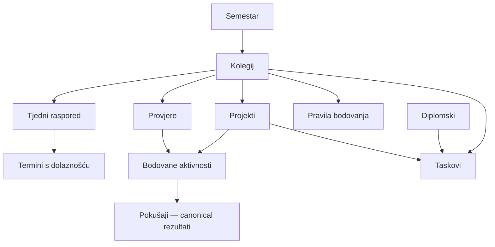

# Firestore — podatkovni i operacijski ugovori

Datum baselinea: 2026-10-07. Update 2026-10-09: schemaVersion=1 za root/active dataset, semesters, preferences/app, courses, scheduleTemplates i sessions implementiran je i testiran lokalno. Assessments/projects/tasks/thesis/scoreActivities/scoreAttempts dodatno su implementirani i testirani lokalno u TASK-006/007. GradingRules/courseOutcomes/installments i manual aktivnosti aktivirani su lokalno u TASK-008/009. TASK-010 aktivira lokalni staged restore prema accepted ADR-004; production Rules ostaju deny-all. Nema primijenjene cloud migracije niti postojećih produkcijskih podataka za migraciju.

## 1. Data access i naming

Cloud Firestore kroz modularni Firebase JS SDK u dedicated data servisima; nema ORM-a niti HTTP API-ja. Kolekcije plural camelCase, atributi camelCase, TypeScript modeli PascalCase. Identitet jednog odobrenog korisnika je UID, ne e-mail.

Putanje:

```text
users/{uid}                              # kontrolni dokument
users/{uid}/datasets/{datasetId}         # metapodaci kopije
users/{uid}/datasets/{datasetId}/{collection}/{recordId}
```

Kontrolni dokument: activeDatasetId, previousDatasetId (nullable), stagingDatasetId (nullable), restoreToken (nullable), dataRevision (integer >=0), schemaVersion (integer), updatedAt (server timestamp). Restore polja postoje zbog sigurnog povrata, dataRevision zbog konflikata i konzistentnog exporta. UID nije u backupu.

Dataset metadata: schemaVersion, state (staging/verifying/active/retained/abandoned), createdAt. Samo jedna active kopija. Root/dataset struktura potrebna je za FR-017, ne za multi-tenancy.

TASK-002/003 implementacija: normalni write ne može mijenjati nijedan dataset pointer niti restore token. TASK-010 dopušta isključivo zasebne validirane restore start/freeze/abort/commit prijelaze; normalna mutacija pointere ne mijenja. Pri istodobnoj inicijalizaciji gubitnik može dobiti Rules denial; adapter tada prihvaća isključivo serverom provjeren root i pripadajući potpuni active metadata kojem odobreni UID već smije pristupiti. Odbijanje drugog UID-a ostaje odbijanje, ne implicitno odobrenje.

Svaki domain dokument: id = path ID, revision (integer >=1), updatedAt (server timestamp) i ispod navedeni fields. Revision je potreban za FR-016. Nullable znači nepoznato, ne nula. Bez arbitrary metadata polja i bez soft-delete timestamps. Zatvoreni skup dozvoljenih polja; string limits u odjeljku validacije.

## 2. Entity registry

| Kolekcija | Polja / tipovi uz zajednička | Veze i constraints |
|---|---|---|
| semesters | name:string; startsOn/endsOn:date; isArchived:bool | startsOn <= endsOn; datumi nastave, ne ispitnog razdoblja |
| preferences | singleton app: activeSemesterId:string/null | Referenca postoji u istoj kopiji; aktivni nije arhiviran |
| courses | semesterId:string; name:string; information:string; links:[{label,url}]; isArchived:bool; attendanceRules:{lecture/exercise:{total:integer/null,minimum:integer/null}} | Semester postoji; 0<=minimum<=total kada poznato; default rules nepoznate |
| scheduleTemplates | courseId:string; kind:lecture/exercise; weekday:1..7; startsAt/endsAt:HH:mm; location:string/null; validFrom/validUntil:date | Unutar semestra, start<end, bez preko-ponoći termina u MVP-u; one template=one attendance unit |
| sessions | courseId:string; templateId:string/null; scheduledOn:date; startsAt/endsAt:HH:mm; kind; location:string/null; isCancelled:bool; attendance:unmarked/present/absent; replacementForId:string/null | Snapshot rasporeda; canceled => unmarked; referentna nadoknada ako postoji u istoj kopiji |
| assessments | courseId:string; name:string; type:quiz/exam/oral/defense/other; scheduledOn:date; scheduledAt:HH:mm/null; isCompleted:bool | Kolegij postoji; attempt history preko scoreActivities/scoreAttempts |
| projects | courseId:string/null; name:string; dueOn:date/null; isCompleted:bool; isArchived:bool | Nullable course; bez kaskade na taskove |
| tasks | title:string; dueOn:date/null; isCompleted:bool; context:{type:none/course/project/thesis,id:string/null} | točno jedan context; none ima null id; thesis koristi main singleton |
| thesis | singleton main: topic:string/null; mentor:string/null; information:string | Smije postojati bez teme/mentora; zadaci u tasks |
| installments | name:string; amountCents:integer>0; dueOn:date; isPaid:bool | EUR implicitno; nema floats novčanih iznosa niti djelomičnih uplata |
| scoreActivities | courseId:string/null; name:string; source:{type:lecture/exercise/assessment/project,id:string/null}; componentKey:string/null; maxPoints:decimalString/null; minimumPoints:decimalString/null | assessment/project source referenca postoji; source jedan, bez duplikata; project bez kolegija može imati rezultat bez course sum |
| scoreAttempts | activityId:string; attemptNumber:integer>=1; takenOn:date/null; points:decimalString/null; grade:string/null | Unique activityId+attemptNumber kroz deterministički ID; canonical rezultat je ovdje |
| gradingRules | ID=courseId: scale:[{grade:string,minInclusive:decimalString,maxExclusive:decimalString/null}]; components:[{key,label,maxPoints:decimalString/null,minimumPoints:decimalString/null}]; countedAttemptIds:[string]; projectPointsIncluded:bool/null; roundingPolicy:string/null; isConfirmed:bool | Ovo je ograničen ugovor za poznate pragove i zbirne bodove; nije univerzalni formula engine. Nedostajuća pravila označena; stvarne skale/odabiri nisu postavljeni |
| courseOutcomes | ID=courseId: officialGrade:string/null; officialPoints:decimalString/null | Ručno službeni rezultat odvojen od izvedenog; nullable dok nepoznat |

DecimalString: nenegativan decimalni string s najviše 4 decimalna mjesta i vrijednošću <=100.000, npr. "7.5". Računanje fixed-point integer skalom 10.000, bez float zbrojeva; ne zaokruživati na cijeli bod. Provjeriti safe-integer kod zbroja. Granica 4 mjesta je tehnički limit; prije stvarnog unosa provjeriti prema pravilima i promijeniti ugovor ako ne odgovara. Ocjene string dopušta različite skale bez tvrdnje da je TVZ skala poznata. Izračun zbroja/ocjene ne sprema se kao drugi izvor istine.

GradingRules.countedAttemptIds predstavlja eksplicitni obračunski izbor, bez best/latest automatizma. UX tog izbora i stvarna konfiguracija čekaju pravila; zato komponenta FR-015 ostaje djelomično definirana. Ne uključiti dva pokušaja iste aktivnosti; svaki ID mora biti rezultat te aktivnosti/kolegija. Component minima, roundingPolicy i finality interpretacija aktiviraju se tek uz dokumentirano pravilo. Ne implementirati arbitrary expressions iz pravila kao izvršivi kod.

## 3. Relationships



## 4. Operations / contract registry

Sve operacije zahtijevaju odobren UID i isti dataset. Canonical aplikacijske greške: validation, unauthenticated, forbidden, notFound, conflict, offline, quotaExceeded, unavailable, restoreInProgress, invalidBackup, unsupportedSchema. Ovo nisu izmišljeni HTTP statusi. UI mapira SDK errors; ne prikazuje internu poruku kao korisnički tekst.

| Op ID | Operacija | Atomarnost / validation | FR |
|---|---|---|---|
| OP-001 | Read active scope | Root pa server query; bez offline authoritative reads | FR-016 |
| OP-002 | Create/edit entity | Transaction: root lock/pointer, record revision, referentni parenti; write record + root dataRevision+1 | FR-003, FR-008–FR-012, FR-014 |
| OP-003 | Mark attendance | Deterministički session ID, transaction, revision i canceled provjera; root revision increment | FR-005 |
| OP-004 | Change future recurrence | Preview datuma primjene; zadržati prošle snapshot-e; samo budući neoznačeni termini izvan novog predloška uklonjivi | FR-004, FR-007 |
| OP-005 | Complete/reopen task/project | Revision transaction; bez automatske kaskade | FR-009, FR-010 |
| OP-006 | Archive parent | Archive flag, refs ostaju; semester aktivni pointer ažurirati zajedno ako potrebno | FR-002 |
| OP-007 | Calculate results | Čista funkcija rezultata+rules, bez zapisa izvedenog zbroja; validira jedinstveni obračunski izvor | FR-015 |
| OP-008 | Export/import | Konzistentna kopija i staged restore po odjeljku 7 | FR-017 |
| OP-009 | Initialize empty control/dataset | Samo odobren UID kada root ne postoji; transaction root + active metadata sa schema=1 i dataRevision=0 | FR-001, FR-016 |

Novi dokument: revision=1. Edit: očekivana revision mora odgovarati serveru; povećati za 1. Transakcijski retry ne smije automatski prihvatiti drukčiji record revision od onog koji je korisnik uređivao. Conflict vraća server zapis i ostavlja lokalni unos. Svaka domain mutacija povećava root dataRevision. Dvije izmjene različitih zapisa mogu se retryati; ista stavka traži korisnički izbor.

Kolegij predstavlja upis u određeni semestar: semesterId se ne mijenja pri edit-u; novi upis dobiva novi ID. Arhiva semestra čuva kolegije i ostale reference te atomarno poništava preferences/app.activeSemesterId ako je taj semestar bio aktualni. Liste imaju limit 50 i cursor po document ID-u; pojedinačni selected/current semestar dohvaća se zasebno ako nije u prvoj stranici. Refresh čita root prije i poslije skupine queryja i ponavlja dohvat ako se dataRevision/pointer/lock promijenio.

Deterministički session ID = stabilni templateId+datum (bez korisničkog inputa u pathu); individualne nadoknade imaju client-generated stabilni UUID prije submit-a. Materializirati termine prikazanog tjedna/potrebnog datuma bez upisa unmarked zapisa dok nema edit-a ili dolaznosti; prošli recorded session nosi snapshot. Idempotency key za create je unaprijed generirani record ID; retry provjerava isti sadržaj umjesto duplikata.

## 5. Validacija i lifecycle

- Naziv/title do 200 znakova, information do 10.000, lokacija do 200, mentor/topic do 500. Trim, naziv nije prazan. Linkovi: http/https URL do 2.000 znakova, label do 200, do 20 po kolegiju, bez ugrađenog username/password ili javascript/data protokola.
- Dates stvarni YYYY-MM-DD, times stvarni HH:mm. Date-only se ne pretvara UTC midnight. Session timezone Europe/Zagreb.
- Zatvoreni enums, integer revision/amounts/totals, konačni broj bez NaN/infinity. Decimal regex i bounds; max/min usporedba gdje poznati. Bez proizvoljnih client fieldova.
- Referential integrity provjerava application transaction i Rules za lokalne reference. Kod normalnog upisa referentni dokument mora postojati; parent brisanje s vezama nije podržana UI operacija.
- Primarna politika: arhivirati semestre/kolegije/projekte. Hard delete samo nepovezanih zapisa: session bez evidencije, task, rata ili prazna provjera/projekt bez zavisnih zapisa. Lista dependents provjerava se prije brisanja; Rules mogu konzervativno zabraniti hard delete parenta. Nemogućnost queries u Rules ne opravdava nezaštićenu kaskadu.
- Arhiva ne briše podatke. Ispravak ima izričit UI ulaz; isti security model kao aktualni podaci.
- SchemaVersion trenutno 1. Promjena schema ugovora dokumentirana, s migracijom i backupom. Ne editirati primijenjenu migraciju bez razloga. Nema stvarne migracije/seeda danas. Test seed isključivo sintetički, production bez fake podataka.

## 6. Query patterns i indeksi

Courses: semesterId; schedule/session: courseId/date range; assessments: courseId/date; tasks: context.type/context.id/isCompleted/dueOn; projects: courseId/isArchived/dueOn; installments: isPaid/dueOn; scoreActivities: courseId/source; scoreAttempts: activityId/attemptNumber. Firestore composite indeks dodati samo za konkretan query i zapisati u tracked firestore.indexes.json pri implementaciji. UUID ID nije vremensko sortiranje; eksplicitno sortirati po domeni. Liste straniti nakon 50 stavki cursorom, bez učitavanja svih dataset-a na Početnoj.

## 7. Konzistentan export i siguran restore

Export envelope: format="kolegium-backup", schemaVersion=1, exportedAt ISO UTC, collections={...} sa record IDs i domain payloadima. Nema UID/tokena/cloud configa, control roota, dataset metadata ni server timestampa/revision iz runtimea. Ograničenja prema TRD; cijelu kopiju validirati prije mrežnog zapisa.

Export: server read root activeDatasetId+dataRevision → čitaj sve kolekcije te kopije → server read root ponovno. Ako se pointer/revision/restore lock promijenio, retry ili conflict, nikad izdati miješanu kopiju. U exportu sačuvati sve semestre/pokušaje; ne samo aktivni semestar.

Restore:

1. Parsiranje/validacija svih tipova, ID-a, referenci, unikatnosti i schema verzije u memoriji. Preview brojeva i eksplicitna potvrda zamjene. Prvo ponuditi export aktualnih podataka.
2. Transaction postavlja restoreToken i stagingDatasetId ako nema drugog restorea; lock onemogućuje sve normalne mutacije na svim uređajima. Drugi klijenti pokazuju da je povrat u tijeku; aktivni prikaz još je stara kopija.
3. U novu staging kopiju upisivati u topološkom redu: semesters → courses → templates → sessions/assessments/projects/thesis → scoreActivities → scoreAttempts → gradingRules/courseOutcomes/tasks/installments/preferences. Nadoknade slijede svoje izvorne termine, kružne veze odbijaju se. Rekreirati revision=1 i server updatedAt. Implementirano: jedan zapis po potvrđenom batchu radi lookup/expression limita; cleanup do 5 brisanja. Nema promjene aktivnog pointera tijekom upisa.
4. Transaction mijenja staging u verifying uz isti token/pointer; nakon toga Rules odbijaju sve stage upise. Server ponovno pročita cijelu zamrznutu kopiju, validira payload/refs/counts i usporedi canonical sadržaj s datotekom. Sve reference moraju biti u istoj kopiji; kontrolni UID iz filea nikad se ne koristi.
5. Jedna transaction provjerava isti restoreToken, stari pointer i verifying metadata, označava novu kopiju active/staru retained, mijenja activeDatasetId, postavlja previousDatasetId, povećava dataRevision i briše lock/staging pointer. Tek tada se prijavljuje uspjeh. Otvoreni klijenti blokiraju stari unos; korisnik eksplicitno učitava novu kopiju, uz potvrdu odbacivanja nespremljenih izmjena.
6. Prekid prije commit-a: stara active kopija ostaje dostupna; U postavkama omogućiti Prekini povrat, koji pod istim tokenom otključava i napušta staging kopiju. Ponovni ulaz prepoznaje lock, ne skriva ga. Staging cleanup ide zasebno uz sigurnosnu provjeru da kopija nije active/previous. Ne brisati prethodnu active kopiju pri aktivaciji.
7. Ako finalni commit uspije, ali odgovor nestane, root pointer određuje je li restore završen; ne ponavljati na slijepo. Ako cleanup ne uspije, označiti tehnički ostatak, active podaci ostaju valjani.

Ovo je mehanizam za sve-ili-ništa vidljivost i recovery. Security Rules validiraju dopuštene putanje/tipove/token i lokalne veze; ne dokazuju same cijeli backup graf. Authorized client mora provesti kompletnu validaciju i readback; testirati prekid u svakoj fazi. Dozvola owneru ne zamjenjuje provjere.

Dataset generacije povećavaju storage/read trošak; aktivna/prethodna i aktualna staging kopija zaštićene su. Starije retained/abandoned kopije ostaju do zasebnog eksplicitnog cleanup-a nakon exporta. Svako brisanje Rules provjeravaju kao orphan, nikad active/previous/staging. Bez odobrenja ne nadograditi plan zbog prostora; prvo export/cleanup.

## 8. Službeni izvori

- [Transactions / batches i getAfter](https://firebase.google.com/docs/firestore/manage-data/transactions)
- [Security Rules](https://firebase.google.com/docs/firestore/security/get-started)
- [Firestore pricing i backup](https://firebase.google.com/docs/firestore/pricing)

Prije implementacije potvrditi lookup/transaction/payload limite za pinned SDK. Bez čitanja tih limita ne povećavati restore chunk ili koristiti jedan golemi batch.

## TASK-004/005 — lokalni ugovor (2026-10-09)

Predviđene kolekcije scheduleTemplates/sessions sada su implementirane kao additive schema v1; postojeći semesters/courses se ne mijenjaju. Nema cloud migracije. Backup i pregled impacta ostaju obvezni prije realne Rules/schema objave.

Virtualni termin ima ID templateId_YYYY-MM-DD. Prva korisnička radnja materializira jedan zapis; ponavljanje iste radnje ne duplicira zapis niti povećava revision. Recorded course/template/date/time/kind/location/replacement snapshot ostaje nepromjenjiv; mijenjaju se attendance/isCancelled. Otkazivanje postavlja unmarked, ponovno aktiviranje ne vraća stari dolazak. Nadoknada je zaseban manual session s referencom na postojeći termin istog kolegija/vrste; dopuštena je izvan redovnog semestra i ulazi u povijest dolaznosti.

Budući edit ima datum primjene >= danas unutar izvornog raspona. Ako nema recorded termina, korekcija na prvi dan može urediti predložak; inače transakcija skraćuje stari do prethodnog dana i kreira novu verziju, uz jedan root increment. Recorded termin u pogođenom budućem razdoblju blokira promjenu. Root revision čita se prije provjere tih termina i ponovno u transakciji, pa paralelni upis zahtijeva refresh. Globalna provjera odsutnosti recorded termina je repository guard; Rules zasebno štite immutable snapshot, nisu dokaz globalnog queryja.

Server queries koriste courseId i date bounds, pagination 50 i kompozitne indekse iz firebase/firestore.indexes.json. Attendance učitava povijest jednog upisa kolegija, uključujući nadoknade izvan semestra. Limit 2000 dokumenata po kolekciji/kolegiju i 1095 dana virtualnog raspona daje vidljivu grešku, ne djelomičan tihi zbroj. Prikaz povijesti i kolegija ima load-more. Cloud index deployment nije provjeren.

Predavanja/vježbe imaju zasebne P/A/U vrijednosti. U uključuje završene neoznačene termine; budući i još nezavršeni nisu propušteni. Canceled se isključuje. Unknown total/minimum je null, poznata nula ostaje nula; postotak se računa samo za official total > 0. Prikaz je osobna evidencija, ne potvrda prolaza. Satnica koristi Europe/Zagreb i osvježava se svake minute.

## TASK-006/007 — lokalna provedba 2026-10-09

Additive schema v1 aktivira predviđene assessments/projects/tasks/thesis/scoreActivities/scoreAttempts kolekcije. Postojeći akademski dokumenti ne mijenjaju oblik. Production ostaje deny-all; nema cloud migracije. Backup/impact review obvezan prije stvarne Rules/schema objave.

Provjera zahtijeva kolegij, stvarni datum i opcionalno Europe/Zagreb vrijeme. Projekt može biti bez kolegija/roka. Obavljeno se mijenja zasebno od rezultata; datum ne dovršava stavku. Projekt se arhivira bez kaskade na taskove/pokušaje. Konzervativna izvedba ne nudi hard delete; Rules ga odbijaju i za nove kolekcije.

Task ima točno jedan context; none/null, course/id, project/id ili thesis/main. Project task ne sprema drugi courseId: kolegij se izvodi iz aktualnog projekta. Thesis singleton main smije imati topic/mentor=null. Reference se provjeravaju u transakciji i Rules.

Prvi pokušaj atomarno stvara canonical activity ID assessment_sourceId ili project_sourceId te scoreAttempt activityId_attemptNumber. Source i courseId moraju odgovarati postojećem izvoru. Deterministički activity ID onemogućuje drugi canonical izvor za istu provjeru/projekt. Activity metadata max/min/componentKey zasad je null; njegovo uređivanje i ostale lecture/exercise aktivnosti slijede TASK-009. Nakon prvog rezultata courseId izvora se ne može premjestiti; UI/error zadržava izvorni kontekst i history. Name activity-a je početni opis; UI prikazuje aktualni naziv izvora, ne drugi rezultat.

AttemptNumber je 1..10.000; novi pokušaj dobiva sljedeći broj iz učitane history, bez best/latest obračunskog izbora. ID i broj ostaju isti pri ispravku. Konkurentno zauzet broj s drugim payloadom daje conflict; isti payload retry vraća postojeći zapis bez revision/root incrementa. Svaki različiti edit provjerava expected revision; nema automatskog prihvaćanja nove revizije. Datum/bodovi/ocjena mogu biti null; 0 se čuva. Grade je plain string do 200 znakova, bez pretpostavke skale. Decimal string do četiri mjesta i 100.000; nema izvedenog zbroja/ocjene u ovoj fazi.

Liste imaju server paging 50/document ID cursor; task context/status filteri server-side. Dodatni parenti za učitane taskove dohvaćaju se izravno, pa povezani projekt izvan prve stranice ne nestaje. Project chooser početno nudi prvih 50; ostale projekte otvoriti iz paginiranog Projects detalja i ondje dodati task. Sve učitane obaveze u listi ostaju dostupne preko load-more. History jednog izvora učitava pageove 50 s vidljivim safety limitom 2000 pokušaja. Course result panel otvara se eksplicitno, čita samo izvore odabranog kolegija (po 50 assessment/project izvora, load-more) i iste canonical attempt-e. Root double-read odbija miješani course rezultat. Nema novog authoritative rezultata na kolegiju.

Kompozitni indeksi: scoreAttempts activityId/attemptNumber; tasks context.type/context.id, context.type/isCompleted, context.type/context.id/isCompleted. Indeksi su konfiguracija za budući cloud deploy, emulator test nije cloud dokaz.

## TASK-008/009 — ugovor lokalne provedbe

Additive schema v1 aktivira installments/gradingRules/courseOutcomes i lecture/exercise scoreActivities. Postojeći dokumenti nisu prepisani; nema cloud migracije. Prije stvarne objave backup i Rules/index impact review. EUR amountCents integer 1..1.000.000.000 (najviše 10.000.000 EUR), UI prihvaća točku/zarez do 2 decimale. Paid/reopen je revision transakcija bez bankovne integracije/djelomične uplate.

Početna koristi isCompleted/isPaid=false i date<=Zagreb today+14; null rokovi nisu među rokovima. Open tasks imaju zaseban isCompleted=false query, uključuju null rok. Nema historical full scan. Svaki izvor stranica 50, Učitaj još povećava count; sve overdue dostupne kroz paging. Archived project/course/semester sadržaji se filtriraju provjerom potrebnih roditelja; više prikaza ne stvara kopije taskova/rezultata. Root double read provjerava dataRevision/pointer/lock.

Manual activity ID lecture_courseId_UUID ili exercise_courseId_UUID, source.id=null. Assessment/project activity ID ostaje sourceType_sourceId. Source/course immutable, metadata name/componentKey/max/min promjenjivi. Lowering max provjerava postojeće pokušaje i root revision; Rules štite max pri upisu pokušaja, ne izvršavaju query svih ranijih pokušaja. Dolaznost ne generira bodove.

GradingRules ID=courseId; ukupno najviše 6 komponenti i poredanih nepreklapajućih intervala, 100 eksplicitnih countedAttemptIds. Izbor grafa i jedinstvene aktivnosti provjerava adapter/pure engine; nije best/latest politika. Potvrda konfiguracije znači da je korisnik provjerio cijeli popis bodovanih aktivnosti prema izvoru. Bez te potvrde nema grade. Nepoznati rezultati nisu zero. Komponente zahtijevaju poznat max/min za potpuni obračun; poznata nula je dopuštena. Podržana je samo eksplicitna roundingPolicy=none, ostale/null daju incomplete. scale lower inclusive/upper exclusive, null upper bez granice; nepokriven zbroj daje incomplete, ne izmišljeni fail. Nedovršene provjere/projekti, nepoznato uključivanje projekta, neodabrani pokušaji/mapping ili nedosegnuti minimumi blokiraju calculated grade.

Zbroj je fixed-point scale 10.000 sa safe integer guardom. Prikaz subtotal-a jasno označava odabrane poznate bodove; null ako nema poznatih odabranih bodova. Nema derived aggregate write-a. CourseOutcome čuva samo ručni officialPoints/officialGrade i prikazuje razliku bez prepisivanja. Grading fetch limit 500 aktivnosti/2000 pokušaja po kolegiju daje grešku, ne partial zbroj.
